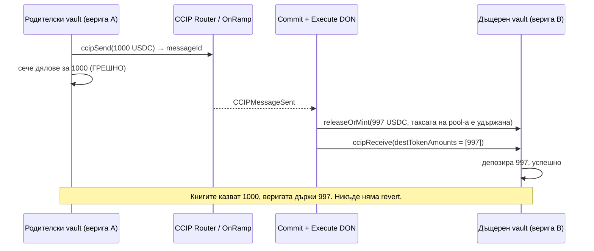

# Успешен ccipSend не е разписка

Вашият vault (трезор) приема депозит в Base. Извиква `ccipSend`, транзакцията се потвърждава, експлорърът светва в зелено и договорът ви сече на вложителя неговите дялове. Готово. Седмици по-късно правите равносметка и дяловете в обращение са покрити с по-малко пари, отколкото показва счетоводството. Без revert. Без провалено съобщение. Без аларма. Просто празнина, която тихо се е отворила и никога не се е затворила.

Точно този сценарий описа Карлос (u/Bloqarl), който ръководи одиторската фирма Zealynx, в r/solidity в края на октомври, след като прегледа стейбълкойн vault на пет вериги, изграден върху Chainlink CCIP. Изречението, което остана: *„при трите бъга, за които продължавам да мисля, всяко извикване беше успешно.“*

Тази статия покрива целия клас проблеми, не един бъг. Ще го откриете във всяка система, в която парите напускат една верига, а на друга пристига обещание: успешното изпращане не е разписка, валидният подпис не е подпис *за вас*, а повторният опит е решение само ако между опитите нещо може да се промени.

Нужен ви е контекст? CCIP е куриерът на Chainlink между вериги: пренася токени плюс малко данни от договор на една верига към договор на друга. ERC-4626 vault е общ депозитен фонд, който издава дялове — вашето парче от пая. Заедно: vault, чиито пари живеят на няколко вериги, докато един родителски договор води счетоводството.

## Проблемът: три бъга, нула revert-а

Прегледаният vault (Yieldcoin v2, 2 610 реда Solidity, пет вериги) има родителски vault, който води книгите, и дъщерни vault-ове на други вериги, които влагат парите в Aave и Compound. Двуседмичният преглед откри 11 проблема. Три от тях имат обща форма: нищо не се проваля, състоянието просто се разминава.

**Бъг 1: изпращането беше третирано като доставка.** Vault-ът сечеше дялове според сумата, която *изпраща*. CCIP token pool-овете могат да начисляват такса за трансфер, така че с включена такса дестинацията получаваше по-малко, отколкото е тръгнало от източника. `ccipSend` връщаше ID на съобщението, съобщението се изпълняваше, а дяловете бяха покрити с по-малко, отколкото казваха книгите.

**Бъг 2: подписаният отчет не назоваваше получателя си.** Дъщерните vault-ове действат по подписани отчети, а подписът покриваше съдържанието, но не и *кой* дъщерен vault е адресатът. Теглене, подписано за vault-а на верига A, можеше да бъде повторено през vault-а на верига B. Този беше оценен като Critical.

**Бъг 3: повторен опит, който никога не може да успее.** Депозитите и тегленията се нетират по епохи (пакетен прозорец). Нетирането можеше да свие депозит до една базова единица USDC. Aave v4 закръгля това до нула дяла и го отхвърля. Vault-ът го съхраняваше за повторен опит; всеки опит се удряше в същата стена и следващите епохи оставаха блокирани зад него.

Това не е история само за Yieldcoin. Собствената документация на Chainlink за receiver-а казва, че съобщение, чийто `ccipReceive` прави revert, „влиза в състояние FAILED и става достъпно за ръчно изпълнение“. Токените не са загубени, но никой няма да каже това на счетоводството ви. Новите CCIP Vault Adapters идват с `refundFailedMessage` и `recoverFailedMessageLocally` — силен намек, че „доставено“ и „депозирано“ са две различни състояния.

## Дебъг танцът

Ето как се разгръща първият бъг, сглобено от темата и от уроците за CCIP.

Някой забелязва, че числата не излизат. Не с много — таксата за трансфер е част от процента — но дялове в обращение по цена на дял вече не е равно на управляваните активи. Първи инстинкт: експлорърът. Всяко съобщение е зелено. Success, success, success. Значи не е CCIP. Ругатня.

Второ предположение: математиката на дяловете. Закръгляне в `mulDiv`, грешна посока някъде. Четете сетълмента на епохата три пъти. Математиката е наред. Никога не е математиката.

Трето: тестовете. Всички зелени. Fuzzer-ът е доволен. Инвариантите държат. В този момент има осем отворени таба и един от тях е страницата от документацията на CCIP за token pool-овете, която никога не сте дочели.

Ето грешния завой, който струва най-много време, и той е в темата дословно: *„Моковете крият и трите. Мок мост винаги доставя пълната сума, а мок pool никога не закръгля до нула.“* Тестовият комплект имаше фалшив router, който мести точно толкова, колкото му кажете. Той не можеше да намери бъга, защото бъгът живее в разликата между това, което сте изпратили, и това, което е пристигнало — а мокът нямаше такава разлика.

Моментът „аха“ идва, когато спрете да четете собствения си код и прочетете структурата, която CCIP подава на вашия receiver. `Client.Any2EVMMessage` има поле `destTokenAmounts`. Това е списъкът с токени, които *реално са пристигнали*, записан от OffRamp-а, не от вас. Числото, което сте изпратили, е във вашето хранилище. Числото, което е кацнало, е в този масив. Vault-ът четеше първото и никога не поглеждаше второто. Нищо не правеше revert, защото от гледната точка на CCIP нищо не беше наред. Съобщението достави малко по-малко, отколкото сте предполагали, точно както е конфигурирано.

Щом видите тази празнина, другите два бъга са същата картина от различни ъгли. Бъг 2: подписът верифицира *съдържанието* на съобщение, не неговата *дестинация*, освен ако дестинацията не е вътре в подписаните байтове. Бъг 3: съхраненият повторен опит предполага, че светът се променя между опитите. Правилото за закръгляне не се променя.




## Решението: съгласувай, обвържи, спри да повтаряш невъзможното

Три поправки, по един принцип за всяка. Кодът е адаптиран от хранилището на Yieldcoin v2 след прегледа, съкратен за четене.

### 1. Сечи според това, което е пристигнало, не според това, което си изпратил

Receiver-ът валидира доставения токен и чете сумата от съобщението. Всичко надолу по веригата използва това число:

```solidity
function _validateReceivedTokenAndGetAmount(
    Client.Any2EVMMessage memory message,
    address asset
) internal pure returns (uint256 amount) {
    if (message.destTokenAmounts.length != 1) {
        revert InvalidTokenAmountsLength(message.destTokenAmounts.length, 1);
    }
    Client.EVMTokenAmount memory t = message.destTokenAmounts[0];
    if (t.token != asset) revert InvalidReceivedToken(t.token, asset);
    amount = t.amount;
    if (amount == 0) revert NoZeroAmount();
}
```

На прост език: „пристигнал е точно един токен, той е токенът, който очаквам, и ето колко. Вярвам на *това* число.“ От страната на родителя поправеният код след това презаписва очакваната стойност с получената и излъчва събитие, ако е по-малко:

```solidity
uint256 expected = provisionalClaim - totalDeposits;
epoch.totalWithdrawClaimAmount = totalDeposits + receivedAmount; // intentional overwrite
if (receivedAmount < expected) {
    emit EpochWithdrawAmountShort(epochNonce, expected, receivedAmount);
}
```

Защо работи: единственият честен източник за „колко има на тази верига“ е самата верига. CCIP попълва `destTokenAmounts`, след като token pool-ът е направил каквото прави (такса, закръгляне, лимит на скоростта). Четете го след това. Никога не го предсказвайте предварително.

Граничен случай: ако ви трябват дялове още при изпращането заради потребителското изживяване, сечете ги условно и ги уредете спрямо получената сума, когато се върне потвърждението. Нищо не е окончателно, докато парите не са преброени от другата страна.

### 2. Сложи получателя вътре в подписа

Подписаният отчет трябва да казва кой договор, на коя верига, има право да действа по него:

```solidity
bytes32 digest = keccak256(abi.encode(
    REPORT_TYPEHASH,
    block.chainid,   // this chain
    address(this),   // this vault, not "a" vault
    i_ccipRouter,    // the router this vault trusts
    reportHash,
    nonce
));
// verify the signer set over `digest`, then consume `nonce`
```

Защо работи: подпис върху байтове, които съдържат `chainid` и `address(this)`, не може да бъде повторен никъде другаде, защото всеки друг vault изчислява различен digest и проверката се проваля. Това е разделянето на домейни от EIP-712, приложено към собствените ви протоколни съобщения. Консумирайте и nonce, така че един отчет да работи точно веднъж.

### 3. Повторният опит е безопасен само ако провалът може да се промени

Преди да съхраните повторен опит, попитайте какво би накарало същото извикване да успее по-късно. Ако отговорът е „нищо“, не го съхранявайте.

```solidity
uint256 previewShares = IERC4626(pool).previewDeposit(amount);
if (previewShares == 0) {
    s_undepositableDust += amount;  // tracked, reported, never retried
    emit DustParked(epochNonce, amount);
    return;
}
_deposit(amount);
```

Защо работи: `previewDeposit` пита pool-а на дестинацията „какво би ми дал за това?“, без да мести средства. Нулев отговор е структурно отхвърляне — закръгляне, не временно състояние. Паркирайте го, осчетоводете го, продължете. Епохата се затваря и следващата не е блокирана.

### Тестът, който намира и трите

Най-добрият отговор в темата, от u/SuperionProtocol, е за дизайна на тестовете: fork тестове срещу истинските token pool-ове плюс *враждебни мокове* — фалшив router, на който можете да кажете да удържи такса, да достави късно, да достави в разбъркан ред, да достави два пъти. Пуснете един и същ комплект инварианти срещу двете. Инвариантът, който си струва да се fuzz-ва, проверяван след всяко извикване на handler:

```text
sharesMinted <= assetsActuallyReceivedOnHub
```

За бъга с повторението евтиният регресионен тест: подайте един валиден подписан отчет към всеки друг receiver и chain ID в тестовата си среда и проверете, че всеки прави revert. Още един безплатно: извадете подписващ от набора и проверете, че отчетите на стария набор се отхвърлят.

## Поуката

Cross-chain кодът е асинхронен код с пари в него. Всеки „успех“, който получавате обратно, е локален: router-ът прие съобщението ви, таксата е платена, събитието е излъчено. Правилото на рецензента за бъга с повторението се обобщава и за трите: *в асинхронен протокол повторният опит е безопасен само ако можете да обясните защо същото извикване би успяло по-късно.* Неговият близнак: число е безопасно за сечене на дялове само ако е измерено на веригата, където са парите.

Един приложим извод: отворете тестовия си комплект и намерете мок моста. Ако той няма начин да достави по-малко, отколкото сте изпратили, имате тест за щастливия път и нищо друго. Дайте му копче за такса още тази вечер.

## Благодарности и допълнително четене

> Тази статия се основава на проблем, обсъден първоначално в [тази тема в r/solidity](https://www.reddit.com/r/solidity/comments/1xh32ob/a_successful_ccipsend_doesnt_mean_the_money/) от `u/Bloqarl` (Zealynx Security), с подхода за дизайн на тестовете от `u/SuperionProtocol`. Прегледаният код е с отворен код в [contractlevel/yield-v2](https://github.com/contractlevel/yield-v2). За по-задълбочено четене вижте официалните [концепции за ръчно изпълнение в CCIP](https://docs.chain.link/ccip/concepts/manual-execution) и [справочника на CCIPReceiver API](https://docs.chain.link/ccip/api-reference/evm/v1.5.1/ccip-receiver).

## Често задавани въпроси

### Ако ccipReceive направи revert, губят ли се токените?

Не. Изпълнението на CCIP на дестинацията е атомарно: ако вашият `ccipReceive` направи revert, трансферът на токени се отменя заедно с него и съобщението се записва като `FAILURE` в OffRamp-а. След това всеки може да го изпълни отново ръчно, през CCIP Explorer или CLI, обикновено с по-висок gas лимит за callback-а. Празни revert данни почти винаги означават, че receiver-ът е останал без gas; непразни данни означават, че собственият ви договор е направил revert и първо трябва да поправите това. За счетоводството важното е, че докато повторният опит не успее, парите са в неопределеност, така че книгите ви трябва да моделират „изпратено, но още неполучено“ като отделно състояние.

### С мокове или с fork-ове да тествам cross-chain код?

И с двете, умишлено. Fork тестовете, закачени за конкретен блок, удрят истинските token pool-ове и истинското поведение на закръгляне на протокола надолу по веригата — там живееха бъговете с таксата за трансфер и закръглянето до нула. Моковете пак са полезни, ако са враждебни: конфигурируеми да удържат такса, да доставят късно, в разбъркан ред или два пъти. Правилото от темата е да се пуска един и същ комплект инварианти срещу двете. Мок, който винаги доставя пълната сума, тества само щастливия път и дава фалшиво чувство за покритие.

### Как да разбера, че receiver-ът ми е получил токени, но не и съобщение?

Проверете `supportsInterface`. Документацията на CCIP за receiver-а казва, че ако адресът получател няма код или `supportsInterface` върне false или направи revert, се прехвърлят само токените, а `ccipReceive` изобщо не се извиква. Договорът ви се оказва с активи без запис защо. Наследяването на `CCIPReceiver` се грижи за това, но прокси или грешно конфигуриран адрес може тихо да попадне в пътя „само токени“. Задавайте `gasLimit` нула само когато получателят наистина е външно притежаван акаунт без логика.

### Гарантира ли изобщо успешният ccipSend доставка?

Гарантира страната на източника: таксата е платена, токените са заключени или изгорени и `CCIPMessageSent` е излъчено, така че изпращането не може да бъде отменено. Доставката все още зависи от финалността на източника (около 13 минути от Ethereum mainnet), от Commit DON, от Execute DON и от това вашият `ccipReceive` да не направи revert. Сумата, която каца, е каквото token pool-ът на дестинацията освободи, а тя може да е по-малка от изпратената. ID-то на съобщението е номер за проследяване, не разписка.
