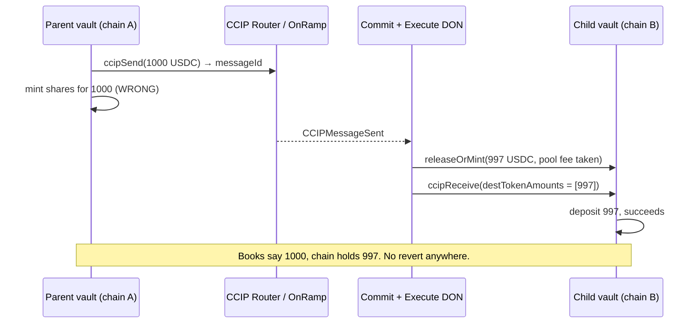

# ccipSend Success Is Not a Receipt

Your vault takes a deposit on Base. It calls `ccipSend`, the transaction confirms, the explorer turns green, and your contract mints the depositor their shares. Done. Weeks later you tally up, and the shares in circulation are backed by less money than the ledger says. No revert. No failed message. No alert. Just a gap that quietly opened and never closed.

That's the scenario Carlos (u/Bloqarl), who runs the audit firm Zealynx, described on r/solidity in late October after reviewing a five-chain stablecoin vault built on Chainlink CCIP. The line that stuck: *"in the three bugs I keep thinking about, every call succeeded."*

This post covers the whole class, not one bug. You'll find it in any system where money leaves one chain and a promise arrives on another: a send that succeeds is not a receipt, a valid signature is not a signature *for you*, and a retry is only a fix if something can change between attempts.

Short on background? CCIP is Chainlink's cross-chain courier: it carries tokens plus a bit of data from a contract on one chain to a contract on another. An ERC-4626 vault is a pooled deposit account that issues shares, your slice of the pot. Together: a vault whose money lives on several chains while one parent contract keeps the books.

## The problem: three bugs, zero reverts

The vault under review (Yieldcoin v2, 2,610 lines of Solidity, five chains) has a parent vault that keeps the books and child vaults on other chains that put money to work in Aave and Compound. The two-week review found 11 issues. Three of them share a shape: nothing fails, the state just drifts.

**Bug 1: the send was treated as delivery.** The vault minted shares from the amount it *sent*. CCIP token pools can charge a transfer fee, so with a fee on, the destination received less than left the source. `ccipSend` returned a message ID, the message executed, and the shares were backed by less than the books said.

**Bug 2: the signed report didn't name its receiver.** Child vaults act on signed reports, and the signature covered the content but not *which* child vault it was for. A withdrawal signed for the vault on chain A could be replayed through the vault on chain B. That one was rated Critical.

**Bug 3: a retry that could never succeed.** Deposits and withdrawals are netted per epoch (a batch window). Netting could shrink a deposit to a single base unit of USDC. Aave v4 rounds that to zero shares and rejects it. The vault stored it for retry; every retry hit the same wall, and later epochs stayed blocked behind it.

This is not a Yieldcoin-only story. Chainlink's own receiver docs say a message whose `ccipReceive` reverts "enters a FAILED state and becomes available for manual execution". The tokens aren't lost, but nobody is going to tell your accounting about it. The new CCIP Vault Adapters ship with `refundFailedMessage` and `recoverFailedMessageLocally`, a strong hint that "delivered" and "deposited" are two different states.

## The debugging dance

Here's how the first bug unfolds, pieced together from the thread and the CCIP tutorials.

Someone notices the numbers are off. Not by much, a transfer fee is a fraction of a percent, but shares outstanding times share price no longer equals assets under management. First instinct: the explorer. Every message is green. Success, success, success. So it's not CCIP. Curse.

Second guess: the share maths. Rounding in `mulDiv`, a direction wrong somewhere. You read the epoch settlement three times. The maths is fine. It's never the maths.

Third: the tests. All green. Fuzzer happy. Invariants hold. At this point there are eight tabs open and one of them is the CCIP token-pool docs page you never fully read.

Here's the wrong turn that costs the most time, and it's in the thread verbatim: *"Mocks hide all three. A mock bridge always delivers the full amount and a mock pool never rounds to zero."* The test suite had a fake router that moved exactly what you asked it to. It couldn't find the bug, because the bug lives in the difference between what you sent and what showed up, and the mock had none.

The aha moment comes when you stop reading your own code and read the struct CCIP hands your receiver. `Client.Any2EVMMessage` has a field called `destTokenAmounts`. It's the list of tokens that *actually arrived*, written by the OffRamp, not by you. The number you sent is in your storage. The number that landed is in that array. The vault read the former and never looked at the latter. Nothing reverted because, from CCIP's point of view, nothing was wrong. The message delivered a bit less than you assumed, exactly as configured.

Once you see that gap, the other two bugs are the same picture from different angles. Bug 2: a signature verifies the *content* of a message, not its *destination*, unless the destination is inside the signed bytes. Bug 3: a stored retry assumes the world changes between attempts. A rounding rule doesn't.




## The solution: reconcile, bind, stop retrying the impossible

Three fixes, one principle each. Code adapted from the post-review Yieldcoin v2 repository, trimmed for reading.

### 1. Mint from what arrived, not what you sent

The receiver validates the delivered token and reads the amount from the message. Everything downstream uses that number:

```solidity
function _validateReceivedTokenAndGetAmount(
    Client.Any2EVMMessage memory message,
    address asset
) internal pure returns (uint256 amount) {
    if (message.destTokenAmounts.length != 1) {
        revert InvalidTokenAmountsLength(message.destTokenAmounts.length, 1);
    }
    Client.EVMTokenAmount memory t = message.destTokenAmounts[0];
    if (t.token != asset) revert InvalidReceivedToken(t.token, asset);
    amount = t.amount;
    if (amount == 0) revert NoZeroAmount();
}
```

In plain English: "exactly one token arrived, it's the token I expect, and here's how much. I trust *this* number." On the parent side, the fixed code then overwrites the expected figure with the received one and emits an event if it came up short:

```solidity
uint256 expected = provisionalClaim - totalDeposits;
epoch.totalWithdrawClaimAmount = totalDeposits + receivedAmount; // intentional overwrite
if (receivedAmount < expected) {
    emit EpochWithdrawAmountShort(epochNonce, expected, receivedAmount);
}
```

Why it works: the only honest source of "how much is on this chain" is the chain. CCIP fills `destTokenAmounts` after the token pool has done whatever it does (fee, rounding, rate limit). Read it after. Never predict it before.

Edge case: if you need shares at send time for the user experience, mint them provisionally and settle against the received amount when the confirmation comes back. Nothing is final until the money is counted on the far side.

### 2. Put the receiver inside the signature

A signed report must say which contract, on which chain, is allowed to act on it:

```solidity
bytes32 digest = keccak256(abi.encode(
    REPORT_TYPEHASH,
    block.chainid,   // this chain
    address(this),   // this vault, not "a" vault
    i_ccipRouter,    // the router this vault trusts
    reportHash,
    nonce
));
// verify the signer set over `digest`, then consume `nonce`
```

Why it works: a signature over bytes that contain `chainid` and `address(this)` can't be replayed anywhere else, because any other vault computes a different digest and the check fails. It's EIP-712 domain separation applied to your own protocol messages. Consume a nonce too, so a report works exactly once.

### 3. A retry is only safe if the failure can change

Before storing a retry, ask what would make the same call succeed later. If the answer is "nothing", don't store it.

```solidity
uint256 previewShares = IERC4626(pool).previewDeposit(amount);
if (previewShares == 0) {
    s_undepositableDust += amount;  // tracked, reported, never retried
    emit DustParked(epochNonce, amount);
    return;
}
_deposit(amount);
```

Why it works: `previewDeposit` asks the destination pool "what would you give me for this?" without moving funds. A zero answer is a structural rejection, rounding, not a transient one. Park it, account for it, move on. The epoch closes and the next one isn't blocked.

### The test that finds all three

The best answer in the thread, from u/SuperionProtocol, is about test design: fork tests against the real token pools, plus *hostile mocks*, a fake router you can tell to skim a fee, deliver late, deliver out of order, deliver twice. Run the same invariant suite against both. The invariant worth fuzzing, checked after every handler call:

```text
sharesMinted <= assetsActuallyReceivedOnHub
```

For the replay bug, the cheap regression test: submit one valid signed report to every other receiver and chain ID in your test setup and assert that every one reverts. One more for free: rotate a signer out and check that the old set's reports are rejected.

## The lesson

Cross-chain code is asynchronous code with money in it. Every "success" you get back is local: the router accepted your message, the fee was paid, the event was emitted. The reviewer's rule for the retry bug generalizes to all three: *in an async protocol, a retry is only safe if you can explain why the same call might succeed later.* Its sibling: a number is only safe to mint against if it was measured on the chain where the money is.

One actionable takeaway: open your test suite and find the mock bridge. If it has no way to deliver less than you sent, you have a happy-path test and nothing else. Give it a fee knob tonight.

## Credit & further reading

> This article is based on a problem originally discussed in [this r/solidity thread](https://www.reddit.com/r/solidity/comments/1xh32ob/a_successful_ccipsend_doesnt_mean_the_money/) by `u/Bloqarl` (Zealynx Security), with the test-design approach from `u/SuperionProtocol`. The reviewed code is open source at [contractlevel/yield-v2](https://github.com/contractlevel/yield-v2). For deeper reading, see the official [CCIP manual execution concepts](https://docs.chain.link/ccip/concepts/manual-execution) and the [CCIPReceiver API reference](https://docs.chain.link/ccip/api-reference/evm/v1.5.1/ccip-receiver).

## Frequently Asked Questions

### If ccipReceive reverts, are the tokens lost?

No. CCIP execution on the destination is atomic: if your `ccipReceive` reverts, the token transfer reverts with it and the message is recorded as `FAILURE` on the OffRamp. Anyone can then re-execute it manually, through the CCIP Explorer or the CLI, usually with a higher gas limit for the callback. Empty revert data almost always means the receiver ran out of gas; non-empty data means your own contract reverted and you need to fix that first. For accounting, the important part is that until the retry succeeds the money is in limbo, so your books should model "sent but not yet received" as its own state.

### Should I test cross-chain code with mocks or forks?

Both, deliberately. Fork tests pinned to a block hit the real token pools and the real rounding behaviour of the downstream protocol, which is where the fee-on-transfer and rounds-to-zero bugs lived. Mocks are still useful if they are hostile: configurable to skim a fee, deliver late, out of order, or twice. The thread's rule of thumb is to run the same invariant suite against both. A mock that always delivers the full amount only tests the happy path and gives a false sense of coverage.

### How do I know my receiver got tokens but no message?

Check `supportsInterface`. The CCIP receiver docs say that if the receiving address has no code, or `supportsInterface` returns false or reverts, only the tokens are transferred and `ccipReceive` is never called. Your contract ends up holding assets with no record of why. Inheriting `CCIPReceiver` handles this, but a proxy or a misconfigured address can silently fall into the tokens-only path. Set `gasLimit` to zero only when the receiver really is an externally owned account with no logic.

### Does a successful ccipSend guarantee delivery at all?

It guarantees the source side: the fee was paid, the tokens were locked or burned, and `CCIPMessageSent` was emitted, so the send can't be cancelled. Delivery still depends on source finality (around 13 minutes from Ethereum mainnet), the Commit DON, the Execute DON, and your `ccipReceive` not reverting. The amount that lands is whatever the destination token pool releases, which can be less than you sent. The message ID is a tracking number, not a receipt.
