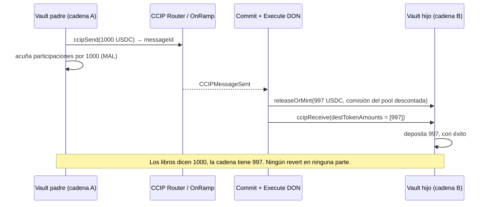

# Un ccipSend exitoso no es un recibo

Tu vault (bóveda) recibe un depósito en Base. Llama a `ccipSend`, la transacción se confirma, el explorador se pone en verde y tu contrato acuña al depositante sus participaciones. Listo. Semanas después haces cuentas y las participaciones en circulación están respaldadas por menos dinero del que dice el libro. Sin revert. Sin mensaje fallido. Sin alerta. Solo una brecha que se abrió en silencio y nunca se cerró.

Ese es el escenario que Carlos (u/Bloqarl), que dirige la firma de auditoría Zealynx, describió en r/solidity a finales de octubre tras revisar un vault de stablecoins en cinco cadenas construido sobre Chainlink CCIP. La frase que se quedó: *"en los tres bugs en los que sigo pensando, cada llamada tuvo éxito."*

Este artículo cubre toda la clase de problemas, no un solo bug. Lo encontrarás en cualquier sistema donde el dinero sale de una cadena y a otra llega una promesa: un envío que tiene éxito no es un recibo, una firma válida no es una firma *para ti*, y un reintento solo es una solución si algo puede cambiar entre intentos.

¿Te falta contexto? CCIP es el mensajero entre cadenas de Chainlink: lleva tokens más un poco de datos de un contrato en una cadena a un contrato en otra. Un vault ERC-4626 es una cuenta de depósito colectiva que emite participaciones, tu trozo del bote. Juntos: un vault cuyo dinero vive en varias cadenas mientras un contrato padre lleva los libros.

## El problema: tres bugs, cero reverts

El vault revisado (Yieldcoin v2, 2.610 líneas de Solidity, cinco cadenas) tiene un vault padre que lleva los libros y vaults hijos en otras cadenas que ponen el dinero a trabajar en Aave y Compound. La revisión de dos semanas encontró 11 problemas. Tres de ellos comparten una forma: nada falla, el estado simplemente se desvía.

**Bug 1: el envío se trató como entrega.** El vault acuñaba participaciones según la cantidad que *enviaba*. Los token pools de CCIP pueden cobrar una comisión de transferencia, así que con la comisión activa el destino recibía menos de lo que salió del origen. `ccipSend` devolvía un ID de mensaje, el mensaje se ejecutaba y las participaciones quedaban respaldadas por menos de lo que decían los libros.

**Bug 2: el informe firmado no nombraba a su receptor.** Los vaults hijos actúan sobre informes firmados, y la firma cubría el contenido pero no *qué* vault hijo era el destinatario. Un retiro firmado para el vault de la cadena A podía reproducirse a través del vault de la cadena B. Ese fue calificado como Critical.

**Bug 3: un reintento que nunca podía tener éxito.** Los depósitos y retiros se netean por época (una ventana por lotes). El neteo podía reducir un depósito a una sola unidad base de USDC. Aave v4 lo redondea a cero participaciones y lo rechaza. El vault lo guardaba para reintentar; cada reintento chocaba con el mismo muro y las épocas siguientes quedaban bloqueadas detrás.

Esta no es una historia solo de Yieldcoin. La propia documentación del receiver de Chainlink dice que un mensaje cuyo `ccipReceive` hace revert "entra en estado FAILED y queda disponible para ejecución manual". Los tokens no se pierden, pero nadie va a avisar a tu contabilidad. Los nuevos CCIP Vault Adapters traen `refundFailedMessage` y `recoverFailedMessageLocally`, una pista clara de que "entregado" y "depositado" son dos estados distintos.

## El baile del debugging

Así se desarrolla el primer bug, reconstruido a partir del hilo y de los tutoriales de CCIP.

Alguien nota que los números no cuadran. No por mucho, una comisión de transferencia es una fracción de un por ciento, pero participaciones en circulación por precio de participación ya no es igual a los activos gestionados. Primer instinto: el explorador. Todos los mensajes en verde. Success, success, success. Así que no es CCIP. Maldición.

Segunda hipótesis: las matemáticas de las participaciones. Redondeo en `mulDiv`, una dirección equivocada en algún sitio. Lees la liquidación de la época tres veces. Las matemáticas están bien. Nunca son las matemáticas.

Tercero: los tests. Todo verde. El fuzzer, contento. Los invariantes se mantienen. A estas alturas hay ocho pestañas abiertas y una de ellas es la página de la documentación de CCIP sobre token pools que nunca terminaste de leer.

Este es el desvío que más tiempo cuesta, y está en el hilo literalmente: *"Los mocks esconden los tres. Un mock de puente siempre entrega la cantidad completa y un mock de pool nunca redondea a cero."* La suite de tests tenía un router falso que movía exactamente lo que le pedías. No podía encontrar el bug, porque el bug vive en la diferencia entre lo que enviaste y lo que llegó, y el mock no tenía ninguna.

El momento ajá llega cuando dejas de leer tu propio código y lees la estructura que CCIP le entrega a tu receiver. `Client.Any2EVMMessage` tiene un campo llamado `destTokenAmounts`. Es la lista de tokens que *realmente llegaron*, escrita por el OffRamp, no por ti. El número que enviaste está en tu storage. El número que aterrizó está en ese array. El vault leía el primero y nunca miraba el segundo. Nada hizo revert porque, desde el punto de vista de CCIP, nada estaba mal. El mensaje entregó un poco menos de lo que asumías, exactamente como estaba configurado.

Una vez ves esa brecha, los otros dos bugs son la misma imagen desde ángulos distintos. Bug 2: una firma verifica el *contenido* de un mensaje, no su *destino*, a menos que el destino esté dentro de los bytes firmados. Bug 3: un reintento guardado asume que el mundo cambia entre intentos. Una regla de redondeo no cambia.




## La solución: concilia, vincula, deja de reintentar lo imposible

Tres arreglos, un principio cada uno. Código adaptado del repositorio de Yieldcoin v2 posterior a la revisión, recortado para su lectura.

### 1. Acuña según lo que llegó, no según lo que enviaste

El receiver valida el token entregado y lee la cantidad del mensaje. Todo lo que viene después usa ese número:

```solidity
function _validateReceivedTokenAndGetAmount(
    Client.Any2EVMMessage memory message,
    address asset
) internal pure returns (uint256 amount) {
    if (message.destTokenAmounts.length != 1) {
        revert InvalidTokenAmountsLength(message.destTokenAmounts.length, 1);
    }
    Client.EVMTokenAmount memory t = message.destTokenAmounts[0];
    if (t.token != asset) revert InvalidReceivedToken(t.token, asset);
    amount = t.amount;
    if (amount == 0) revert NoZeroAmount();
}
```

En lenguaje llano: "llegó exactamente un token, es el token que espero y esta es la cantidad. Confío en *este* número." En el lado del padre, el código corregido sobrescribe después la cifra esperada con la recibida y emite un evento si llegó corta:

```solidity
uint256 expected = provisionalClaim - totalDeposits;
epoch.totalWithdrawClaimAmount = totalDeposits + receivedAmount; // intentional overwrite
if (receivedAmount < expected) {
    emit EpochWithdrawAmountShort(epochNonce, expected, receivedAmount);
}
```

Por qué funciona: la única fuente honesta de "cuánto hay en esta cadena" es la cadena. CCIP rellena `destTokenAmounts` después de que el token pool haya hecho lo que hace (comisión, redondeo, límite de tasa). Léelo después. Nunca lo predigas antes.

Caso límite: si necesitas participaciones en el momento del envío por experiencia de usuario, acúñalas de forma provisional y liquídalas contra la cantidad recibida cuando vuelva la confirmación. Nada es definitivo hasta que el dinero se cuenta en el otro lado.

### 2. Mete al receptor dentro de la firma

Un informe firmado debe decir qué contrato, en qué cadena, puede actuar sobre él:

```solidity
bytes32 digest = keccak256(abi.encode(
    REPORT_TYPEHASH,
    block.chainid,   // this chain
    address(this),   // this vault, not "a" vault
    i_ccipRouter,    // the router this vault trusts
    reportHash,
    nonce
));
// verify the signer set over `digest`, then consume `nonce`
```

Por qué funciona: una firma sobre bytes que contienen `chainid` y `address(this)` no puede reproducirse en ningún otro sitio, porque cualquier otro vault calcula un digest distinto y la comprobación falla. Es la separación de dominios de EIP-712 aplicada a los mensajes de tu propio protocolo. Consume también un nonce, para que un informe funcione exactamente una vez.

### 3. Un reintento solo es seguro si el fallo puede cambiar

Antes de guardar un reintento, pregunta qué haría que la misma llamada tuviera éxito más tarde. Si la respuesta es "nada", no lo guardes.

```solidity
uint256 previewShares = IERC4626(pool).previewDeposit(amount);
if (previewShares == 0) {
    s_undepositableDust += amount;  // tracked, reported, never retried
    emit DustParked(epochNonce, amount);
    return;
}
_deposit(amount);
```

Por qué funciona: `previewDeposit` le pregunta al pool de destino "¿qué me darías por esto?" sin mover fondos. Una respuesta cero es un rechazo estructural, redondeo, no uno transitorio. Apárcalo, contabilízalo, sigue adelante. La época se cierra y la siguiente no queda bloqueada.

### El test que encuentra los tres

La mejor respuesta del hilo, de u/SuperionProtocol, trata del diseño de tests: tests sobre fork contra los token pools reales, más *mocks hostiles*, un router falso al que puedes decirle que descuente una comisión, entregue tarde, entregue fuera de orden, entregue dos veces. Ejecuta la misma suite de invariantes contra ambos. El invariante que merece la pena fuzzear, comprobado tras cada llamada a un handler:

```text
sharesMinted <= assetsActuallyReceivedOnHub
```

Para el bug de replay, el test de regresión barato: envía un informe firmado válido a todos los demás receivers y chain IDs de tu entorno de test y comprueba que todos hacen revert. Uno más gratis: retira a un firmante del conjunto y comprueba que los informes del conjunto antiguo se rechazan.

## La lección

El código cross-chain es código asíncrono con dinero dentro. Cada "éxito" que recibes es local: el router aceptó tu mensaje, la comisión se pagó, el evento se emitió. La regla del revisor para el bug de reintento se generaliza a los tres: *en un protocolo asíncrono, un reintento solo es seguro si puedes explicar por qué la misma llamada podría tener éxito más tarde.* Su hermana: un número solo es seguro para acuñar si se midió en la cadena donde está el dinero.

Una acción concreta: abre tu suite de tests y busca el mock del puente. Si no tiene forma de entregar menos de lo que enviaste, tienes un test del camino feliz y nada más. Ponle un botón de comisión esta noche.

## Créditos y lecturas adicionales

> Este artículo se basa en un problema discutido originalmente en [este hilo de r/solidity](https://www.reddit.com/r/solidity/comments/1xh32ob/a_successful_ccipsend_doesnt_mean_the_money/) por `u/Bloqarl` (Zealynx Security), con el enfoque de diseño de tests de `u/SuperionProtocol`. El código revisado es de código abierto en [contractlevel/yield-v2](https://github.com/contractlevel/yield-v2). Para profundizar, consulta los [conceptos de ejecución manual de CCIP](https://docs.chain.link/ccip/concepts/manual-execution) oficiales y la [referencia de la API de CCIPReceiver](https://docs.chain.link/ccip/api-reference/evm/v1.5.1/ccip-receiver).

## Preguntas frecuentes

### Si ccipReceive hace revert, ¿se pierden los tokens?

No. La ejecución de CCIP en el destino es atómica: si tu `ccipReceive` hace revert, la transferencia de tokens se revierte con él y el mensaje queda registrado como `FAILURE` en el OffRamp. Cualquiera puede entonces volver a ejecutarlo manualmente, a través del CCIP Explorer o de la CLI, normalmente con un límite de gas mayor para el callback. Datos de revert vacíos casi siempre significan que el receiver se quedó sin gas; datos no vacíos significan que tu propio contrato hizo revert y primero tienes que arreglar eso. Para la contabilidad, lo importante es que hasta que el reintento tenga éxito el dinero está en el limbo, así que tus libros deberían modelar "enviado pero aún no recibido" como un estado propio.

### ¿Debo probar código cross-chain con mocks o con forks?

Con ambos, deliberadamente. Los tests sobre fork fijados a un bloque tocan los token pools reales y el comportamiento real de redondeo del protocolo de destino, que es donde vivían los bugs de comisión de transferencia y de redondeo a cero. Los mocks siguen siendo útiles si son hostiles: configurables para descontar una comisión, entregar tarde, fuera de orden o dos veces. La regla general del hilo es ejecutar la misma suite de invariantes contra ambos. Un mock que siempre entrega la cantidad completa solo prueba el camino feliz y da una falsa sensación de cobertura.

### ¿Cómo sé si mi receiver recibió tokens pero ningún mensaje?

Comprueba `supportsInterface`. La documentación del receiver de CCIP dice que si la dirección receptora no tiene código, o `supportsInterface` devuelve false o hace revert, solo se transfieren los tokens y `ccipReceive` nunca se llama. Tu contrato acaba con activos sin registro de por qué. Heredar de `CCIPReceiver` lo gestiona, pero un proxy o una dirección mal configurada puede caer en silencio en la ruta de solo tokens. Pon `gasLimit` a cero solo cuando el receptor sea de verdad una cuenta de propiedad externa sin lógica.

### ¿Un ccipSend exitoso garantiza la entrega?

Garantiza el lado del origen: la comisión se pagó, los tokens se bloquearon o quemaron y se emitió `CCIPMessageSent`, así que el envío no puede cancelarse. La entrega sigue dependiendo de la finalidad del origen (unos 13 minutos desde Ethereum mainnet), del Commit DON, del Execute DON y de que tu `ccipReceive` no haga revert. La cantidad que aterriza es la que libere el token pool de destino, que puede ser menor de lo que enviaste. El ID del mensaje es un número de seguimiento, no un recibo.
